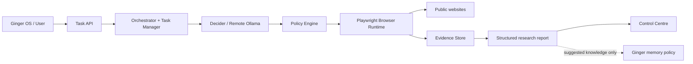

# Ginger Night Walker

Ginger Night Walker is Ginger OS's local-first, policy-governed capability for **general-purpose web browsing, research and evidence capture**. It supports discovery, investigation, comparisons, structured extraction and evidence-backed synthesis. Product lookup is one use case, not the product definition.

The core trust boundary is deliberate:

- **Browsing** records what a browser actually visited and observed.
- **Research** evaluates evidence, connects findings to sources and communicates uncertainty.
- **Memory** decides what Ginger should retain, trust and reuse.

A page visit is not proof that a page's claims are true. A research report is not automatically permanent memory.

## Documentation

Start with the [documentation index](docs/README.md).

| Document | Contents |
|---|---|
| [Architecture](docs/architecture.md) | Responsibilities, component boundaries, lifecycle and Mermaid diagrams |
| [Research report standard](docs/research-report-standard.md) | Canonical report contract, finding quality, evidence provenance and validation |
| [Security and trust](docs/security-and-trust.md) | Threat model, security boundaries and deployment requirements |
| [Development and operations](docs/development-and-operations.md) | Setup, configuration, API, CI, testing and troubleshooting |
| [ADR 0001](docs/decisions/0001-separate-browsing-research-and-memory.md) | Separation of browsing, research and memory |

## Architecture at a glance



The model proposes a bounded plan. Trusted code validates it and owns browser execution. Website content is untrusted input and cannot grant permissions or override policy.

## Current capabilities and limits

Implemented baseline:
- natural-language task submission, clarification and active-task follow-up instructions;
- iterative multi-source research across up to 30 bounded browser rounds;
- task-scoped scratchpad notes that seed subsequent rounds without replaying full chat history;
- progressive round-completion updates, partial reports and operator cancellation;
- remote Ollama structured planning plus a dedicated small-model Goal State Manager;\n- evidence-gated success criteria: the goal model must provide a quote from a captured evidence record, and Python verifies the quote before marking a criterion complete;\n- optional Strands Decider integration for selecting among browser-discovered source URLs (no direct browser tools);
- task-isolated Playwright browser contexts;
- application-level public URL validation and request interception;
- same-origin anchor navigation;
- bounded page title, heading and visible-text capture;
- task-scoped JSON evidence records;
- a generic report envelope with answer, findings, sources, evidence, structured data, limitations and suggested memory;
- React + TypeScript operator UI.

Partial or not yet implemented:
- source discovery begins from a search-engine results page or explicit user URL, then follows links actually observed by the browser; coverage depends on those search results and links;
- product name/price parsing is a specialised extraction adapter;
- goal completion is evidence-gated but still model-assisted; it does not prove a source's real-world truth; broader claim validation remains future work;
- synthesis uses captured page titles, headings and visible-text excerpts; deeper claim extraction, authority assessment and conflict reconciliation remain future work;
- scratchpad/evidence records persist to the evidence volume, but task state is still in memory and cannot automatically resume after service restart;
- automatic Ginger memory writes are intentionally not implemented;
- arbitrary interactions, form submission, purchases, downloads and transactions are not supported;
- the service is not hardened or authenticated for hostile multi-user workloads.

The Goal-Aware Strands prototype is retained under `integrations/goal_aware_strands/`. Its goal-state and Strands decision concepts are integrated into the core; its direct Playwright MCP executor and coding-model tool-argument loop are intentionally not used because they bypass Night Walker's central BrowserRuntime and PolicyEngine.\n\nSee the architecture and security documents for the full implementation-status matrix and required hardening.

## Quick start

Python dependency management uses **uv**; do not use pip.

```bash
cp .env.example .env
# Configure the remote Ollama endpoint and model in .env.
docker compose up --build -d
docker compose ps
curl -fsS http://localhost:8000/health
curl -fsS http://localhost:8000/health/ollama
```

The UI is served at [http://localhost:8000/](http://localhost:8000/). The Docker Compose port binds to localhost by default. Keep it private: authentication and multi-user authorization are not implemented.

For local development and operational details, see [Development and operations](docs/development-and-operations.md).

## Core standards

- Models propose; trusted code validates and executes.
- Permissions are server-side and default-deny.
- Agents receive minimized, capability-scoped context rather than inherited conversation histories.
- Evidence identifiers are generated by the trusted evidence store.
- Findings must distinguish observations, source-reported claims, derivations and inferences.
- Source URL, title and retrieval time should be preserved.
- Missing information, access failures, ambiguity and uncertainty must be visible.
- Structured data is task-specific; the report envelope is generic.
- Suggested memory is only a candidate for Ginger's memory policy.
- Browser actions remain read-only unless a separately reviewed capability is introduced.

## Quality gates

CI currently runs Ruff, pytest and a Vite production build. Use the commands below locally:

```bash
uv sync --group dev
uv run ruff check .
uv run pytest
cd frontend
npm install
npm run build
```

Documentation is part of the engineering contract: update diagrams, schemas, security notes, API tables and implementation status whenever behavior or boundaries change.
