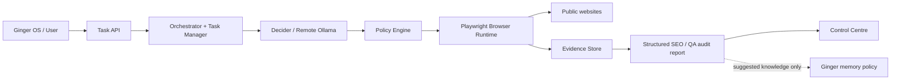

# Ginger Night Walker

Ginger Night Walker is Ginger OS's local-first, policy-governed **website SEO and QA audit platform**. Its first product phase has two explicit workflows: evidence-backed SEO audits and read-only website/application QA. General-purpose and deep research are deferred; they are not fallback routes for failed audits.

The core trust boundary is deliberate:

- **Browsing** records what a browser actually visited and observed.
- **Research** evaluates evidence, connects findings to sources and communicates uncertainty.
- **Memory** decides what Ginger should retain, trust and reuse.

A page visit is not proof that a page's claims are true. A research report is not automatically permanent memory.

## Documentation

Start with the [documentation index](docs/README.md).

| Document | Contents |
|---|---|
| [Product scope](docs/product-scope.md) | Initial SEO/QA focus, intent routing and deferred capabilities |
| [SEO/QA audit engine](docs/seo-qa-audit-engine.md) | Crawl limits, SEO checks, QA smoke checks, reporting and honest coverage |
| [Architecture](docs/architecture.md) | Responsibilities, component boundaries, lifecycle and Mermaid diagrams |
| [Research report standard](docs/research-report-standard.md) | Canonical report contract, finding quality, evidence provenance and validation |
| [Security and trust](docs/security-and-trust.md) | Threat model, security boundaries and deployment requirements |
| [Development and operations](docs/development-and-operations.md) | Setup, configuration, API, CI, testing and troubleshooting |
| [ADR 0001](docs/decisions/0001-separate-browsing-research-and-memory.md) | Separation of browsing, research and memory |

## Architecture at a glance



The model proposes a bounded plan. Trusted code validates it and owns browser execution. Website content is untrusted input and cannot grant permissions or override policy.

## Current capabilities and limits

Implemented baseline:
- explicit SEO, QA and combined SEO+QA task routing; unrelated general research is blocked in this product phase;
- workflow-specific plans with evidence-required acceptance criteria;
- same-origin deterministic audit crawling, default budget 200 pages (configurable with `AUDIT_MAX_PAGES`, 1-1,000), with crawl completion withheld while discovered or sampled sitemap URLs remain unvisited;
- robots.txt policy inspection, bounded sitemap and sitemap-index discovery, and same-origin URL filtering;
- per-page HTTP outcome, title, description, canonical, robots, headings, language, viewport, image-alt, JSON-LD syntax and internal-link observations;
- duplicate canonical, title, meta-description and exact visible-text analysis across inspected pages;
- internal destination verification using HEAD with GET fallback only when HEAD is unsupported;
- deterministic finding priorities (P0-P4), impact rationale, effort estimate, affected URLs and remediation guidance;
- QA responsive overflow sampling at 375px, 768px and 1280px, semantic/accessibility heuristics, keyboard focus sampling, safe same-origin GET navigation journeys, reversible local disclosure toggles and browser runtime diagnostics;
- evidence-linked findings, crawl coverage statistics, structured report summaries, durable task snapshots and restart recovery;
- task-isolated Playwright browser contexts, URL policy enforcement, and React + TypeScript operator UI.

Partial or not yet implemented:
- crawl coverage is bounded by discovered links, sitemap sample size and the configured page budget; it is not a guarantee that every route, orphan page or JavaScript-only URL was discovered;
- Core Web Vitals, field/lab performance metrics, search ranking/traffic/backlink data and full Schema.org validation are not measured;
- QA journeys are read-only navigation smoke tests; forms are not submitted, state-changing controls are not activated, and SPA workflows/authentication/transactions are not tested;
- accessibility checks are heuristics and a short keyboard focus sample, not automated WCAG conformance or screen-reader certification;
- visual regression, exhaustive responsive interaction testing, browser-console/network failure aggregation and regression suites remain future work;
- product extraction and generic research code remain for legacy compatibility but are not first-phase product workflows;
- the service is not hardened or authenticated for hostile multi-user workloads.

The Goal-Aware Strands prototype is retained under `integrations/goal_aware_strands/`. Its goal-state and Strands decision concepts are integrated into the core; its direct Playwright MCP executor and coding-model tool-argument loop are intentionally not used because they bypass Night Walker's central BrowserRuntime and PolicyEngine.

See the architecture and security documents for the full implementation-status matrix and required hardening.

## Quick start

Python dependency management uses **uv**; do not use pip.

```bash
cp .env.example .env
# Configure the remote Ollama endpoint and model in .env.
docker compose up --build -d
docker compose ps
curl -fsS http://localhost:8000/health
curl -fsS http://localhost:8000/health/ollama
```

The UI is served at [http://localhost:8000/](http://localhost:8000/). The Docker Compose port binds to localhost by default. Keep it private: authentication and multi-user authorization are not implemented.

For local development and operational details, see [Development and operations](docs/development-and-operations.md).

## Core standards

- Models propose; trusted code validates and executes.
- Permissions are server-side and default-deny.
- Agents receive minimized, capability-scoped context rather than inherited conversation histories.
- Evidence identifiers are generated by the trusted evidence store.
- Findings must distinguish observations, source-reported claims, derivations and inferences.
- Source URL, title and retrieval time should be preserved.
- Missing information, access failures, ambiguity and uncertainty must be visible.
- Structured data is task-specific; the report envelope is generic.
- Suggested memory is only a candidate for Ginger's memory policy.
- Browser actions remain read-only unless a separately reviewed capability is introduced.

## Quality gates

The GitHub Actions CI workflow is intentionally disabled during beta. Run the checks below locally before deploying:

```bash
uv sync --group dev
uv run ruff check .
uv run pytest
cd frontend
npm install
npm run build
```

Documentation is part of the engineering contract: update diagrams, schemas, security notes, API tables and implementation status whenever behavior or boundaries change.
