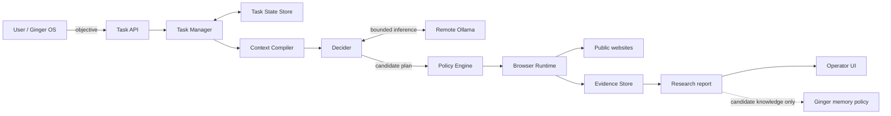
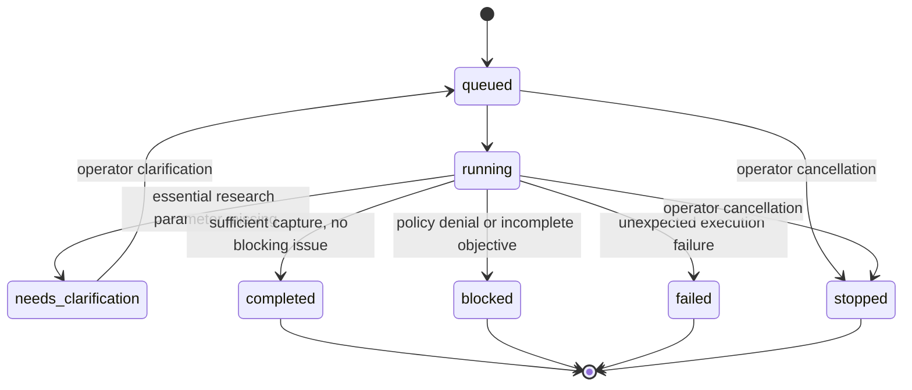
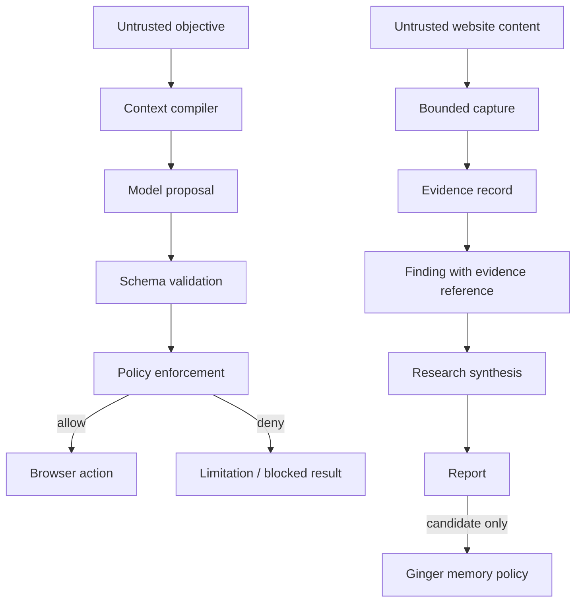

# System architecture

**Status:** current architecture with implementation gaps explicitly called out.  
**Scope:** Ginger Night Walker is a general-purpose web browsing, research and evidence capture capability for Ginger OS. It is not a product scraper.

## 1. Design principles

1. **Objective-led:** accept the desired outcome, not a user-authored browser script.
2. **Least privilege:** task plans propose work; policy and runtime enforce what can execute.
3. **Context isolation:** agents receive only the minimum task packet needed for their capability.
4. **Evidence before conclusions:** distinguish what was observed from what is inferred.
5. **Source traceability:** findings should be traceable to source records and evidence.
6. **No silent memory writes:** research may suggest knowledge; Ginger's memory policy decides retention.
7. **Fail visibly:** blocked actions, access failures, ambiguity and uncertainty belong in the report.
8. **Composable output:** structured data is task-specific; the report envelope remains stable.

## 2. Responsibility boundaries

| Component | Owns | Must not own |
|---|---|---|
| Ginger OS / caller | User intent, identity, memory policy and downstream use | Browser implementation details |
| Task API / Task Manager | Task lifecycle, status, clarification, progress events, cancellation, scratchpad coordination and checkpoint recovery | Permission escalation |
| Task State Store | Atomic task snapshots and resumable research checkpoints on the persistent evidence volume | Browser policy or model decisions |
| Context Compiler | Minimal capability-scoped input packets | Shared conversation-history inheritance |
| Decider | Candidate plan, target suggestion and clarification | Browser actions, policy grants, truth verification |
| Goal State Manager | Immutable original objective, success criteria and evidence-gated progress ledger | Declaring completion without exact captured evidence |
| Optional Strands Decider | Chooses among browser-discovered source candidates | Direct browser access, URL invention or policy decisions |
| Research Loop Guard | Canonical URL deduplication, repeat detection, bounded retries and deterministic source fallback | Changing task goals or relaxing URL policy |
| Policy Engine | URL and capability allow/deny decisions | Model reasoning |
| Browser Runtime | Playwright lifecycle, navigation, capture and runtime enforcement | Memory writes or unsupported actions |
| Evidence Store | Immutable task-scoped capture records | Declaring claims true |
| Research synthesis | Bounded synthesis over source-linked observations, uncertainty and gaps | Changing browser permissions |
| Ginger memory subsystem | Retention, trust, expiry and reuse decisions | Treating every capture as durable memory |

## 3. System context



The dotted memory relationship is a proposal boundary, not an implemented automatic write.

## 4. Task lifecycle



Task records and resumable research checkpoints are persisted as atomic JSON snapshots under `EVIDENCE_DIR/tasks` (or `TASK_STATE_DIR`). On startup, queued/running tasks are restored and resumed from their last checkpoint. A crash during a page inspection may cause that single source to be attempted again; the loop guard bounds retries. Clarification-waiting and terminal tasks are restored without being restarted.

## 5. Browser execution sequence

```mermaid
sequenceDiagram
    participant Caller as Ginger / User
    participant API
    participant TM as Task Manager
    participant D as Decider
    participant LLM as Remote Ollama
    participant P as Policy Engine
    participant B as Browser Runtime
    participant E as Evidence Store
    participant TS as Task State Store
    Caller->>API: POST /tasks objective
    API->>TM: create task
    TM->>TS: persist task and latest checkpoint
    TM->>D: decide objective / initial search URL
    TM->>LLM: extract immutable success criteria (Qwen3 0.6B)
    LLM-->>TM: criteria proposal; Python stores original goal
    D->>LLM: bounded structured request
    LLM-->>D: candidate DecisionPlan
    D-->>TM: validated plan or clarification
    loop Up to 30 research rounds
        TM->>TM: loop guard deduplicates URLs and detects repeated source/action attempts
        TM->>P: validate discovered public URL
        P-->>B: permitted public URL
        B->>B: isolated Playwright context; capture text and links
        B->>E: persist evidence
        E-->>TM: evidence identifier and observations
        TM->>TS: atomically save completed-round checkpoint
        TM->>TM: append scratchpad and publish progress
        TM->>LLM: compact objective + scratchpad + discovered URLs
        LLM-->>TM: next discovered URL or done
    end
    TM->>LLM: evidence-constrained final synthesis
    LLM-->>TM: concise answer and evidence gaps
    TM-->>API: partial/final report and progress events
    API-->>Caller: poll task state; accept follow-ups or cancellation
    API-->>Caller: poll task result
```

## 6. Trust and data flow



Website text, metadata, links and embedded instructions are untrusted input. They must never override system policy, task permissions or model instructions.

## 7. Current implementation status

| Capability | Status | Notes |
|---|---|---|
| Natural-language task intake | Implemented | `POST /tasks` |
| Structured Decider plan | Implemented | Remote Ollama; general research defaults to public search discovery when no site is specified; clarifies only for essential missing scope |
| Goal State Manager | Initial implementation | Dedicated `OLLAMA_MODEL_GOAL_STATE` proposes criteria and evidence quotes; Python verifies exact quote and evidence ID before completion |
| Strands Decider integration | Optional | `STRANDS_DECIDER_URL` selects only among discovered source candidates; falls back to Ollama planner; no direct browser tools |
| Task-scoped Playwright context | Implemented | Context closed after each run |
| Public URL validation | Implemented | Application-level DNS/IP checks; not a complete egress firewall |
| Same-origin anchor navigation | Partial | Heuristic relevance matching; not general-purpose interaction |
| Visible text and heading capture | Implemented | Bounded capture on each inspected source page |
| Immutable evidence JSON | Implemented | Task-scoped file record |
| Task scratchpad | Implemented | Append-only task-scoped round notes; compact recent notes seed the next planner call |
| Progress events | Implemented | Round-completion, follow-up, clarification, cancellation and final milestone events are exposed to the UI |
| Operator cancellation | Implemented | DELETE `/tasks/{task_id}` cancels active work and marks queued/clarification-waiting tasks stopped |
| Durable task snapshots | Implemented | Atomic per-task JSON snapshots under the persistent evidence volume |
| Restart recovery | Initial implementation | Startup restores queued/running tasks; resumes from the last saved round checkpoint; an interrupted in-flight page may be retried once |
| Generic report envelope | Partial | Aggregated multi-source findings, source/evidence references and synthesis; richer claim validation remains |
| Product name/price extraction | Specialised partial capability | One task-specific structured-data adapter |
| Multi-source research | Initial implementation | Up to 30 rounds; starts from a search result or explicit URL and selects only browser-discovered links |
| Research loop detection and recovery | Initial implementation | Canonical URL deduplication; maximum two attempts per URL; duplicate/ exhausted URLs skipped; deterministic fallback to another discovered candidate; bounded recent outcome history |
| Evidence-constrained synthesis | Initial implementation | Summarises captured titles, headings and visible-text excerpts; gaps are reported |
| Active task follow-ups | Implemented | User instructions are appended to the task context for subsequent rounds |
| Research-grade claim/evidence graph | Partial | Each captured finding carries source and evidence IDs; claim-level validation and conflict graph remain planned |
| Durable multi-worker queue/database | Planned | Current store is single-process atomic JSON, not a transactional multi-worker queue or database |
| Automatic memory retention | Not implemented by design | Ginger owns this decision |
| Arbitrary interaction, form submission, transactions | Not supported | Read-only baseline |

## 8. Scaling path

1. Stabilise and version the report/evidence contracts.
2. Move from single-process JSON snapshots to a transactional task store/queue before introducing multiple workers.
3. Improve source discovery with a configurable search-provider abstraction and relevance filtering.
4. Add stronger finding-to-evidence validation and claim-level extraction.
5. Add source authority, freshness and disagreement analysis.
6. Add retention controls and monitoring schedules only after scheduler, authorization and lifecycle controls exist.
7. Add monitoring schedules only after scheduler, authorization and lifecycle controls exist.
8. Expand browser interaction only through explicit capability grants and independently tested policy enforcement.
