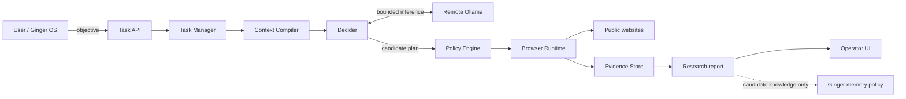
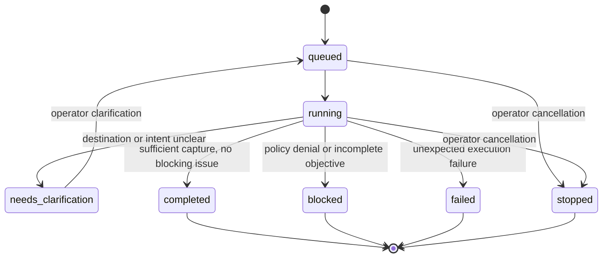
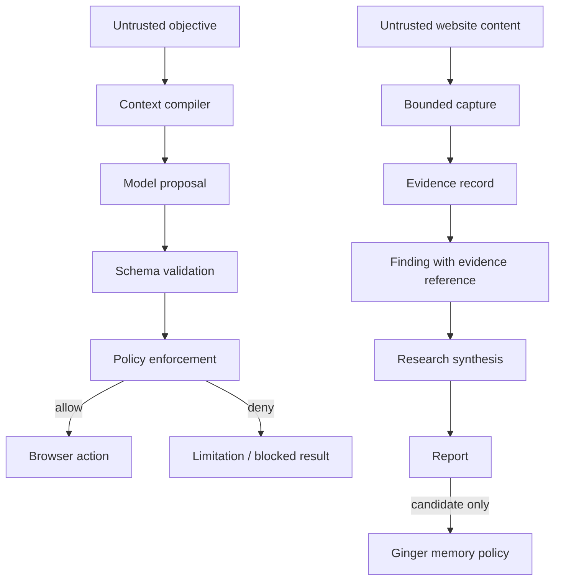

# System architecture

**Status:** current architecture with implementation gaps explicitly called out.  
**Scope:** Ginger Night Walker is a general-purpose web browsing, research and evidence capture capability for Ginger OS. It is not a product scraper.

## 1. Design principles

1. **Objective-led:** accept the desired outcome, not a user-authored browser script.
2. **Least privilege:** task plans propose work; policy and runtime enforce what can execute.
3. **Context isolation:** agents receive only the minimum task packet needed for their capability.
4. **Evidence before conclusions:** distinguish what was observed from what is inferred.
5. **Source traceability:** findings should be traceable to source records and evidence.
6. **No silent memory writes:** research may suggest knowledge; Ginger's memory policy decides retention.
7. **Fail visibly:** blocked actions, access failures, ambiguity and uncertainty belong in the report.
8. **Composable output:** structured data is task-specific; the report envelope remains stable.

## 2. Responsibility boundaries

| Component | Owns | Must not own |
|---|---|---|
| Ginger OS / caller | User intent, identity, memory policy and downstream use | Browser implementation details |
| Task API / Task Manager | Task lifecycle, status, clarification, progress events, cancellation and scratchpad coordination | Permission escalation |
| Context Compiler | Minimal capability-scoped input packets | Shared conversation-history inheritance |
| Decider | Candidate plan, target suggestion and clarification | Browser actions, policy grants, truth verification |
| Policy Engine | URL and capability allow/deny decisions | Model reasoning |
| Browser Runtime | Playwright lifecycle, navigation, capture and runtime enforcement | Memory writes or unsupported actions |
| Evidence Store | Immutable task-scoped capture records | Declaring claims true |
| Research synthesis (planned) | Cross-source comparison, claim synthesis and uncertainty | Changing browser permissions |
| Ginger memory subsystem | Retention, trust, expiry and reuse decisions | Treating every capture as durable memory |

## 3. System context



The dotted memory relationship is a proposal boundary, not an implemented automatic write.

## 4. Task lifecycle



Current implementation stores tasks in process memory. Restarting the service loses task state; durable task storage and resumability are future work.

## 5. Browser execution sequence

```mermaid
sequenceDiagram
    participant Caller as Ginger / User
    participant API
    participant TM as Task Manager
    participant D as Decider
    participant LLM as Remote Ollama
    participant P as Policy Engine
    participant B as Browser Runtime
    participant E as Evidence Store
    Caller->>API: POST /tasks objective
    API->>TM: create task
    TM->>D: decide objective / initial search URL
    D->>LLM: bounded structured request
    LLM-->>D: candidate DecisionPlan
    D-->>TM: validated plan or clarification
    loop Up to 30 research rounds
        TM->>P: validate discovered public URL
        P-->>B: permitted public URL
        B->>B: isolated Playwright context; capture text and links
        B->>E: persist evidence
        E-->>TM: evidence identifier and observations
        TM->>TM: append scratchpad and publish progress
        TM->>LLM: compact objective + scratchpad + discovered URLs
        LLM-->>TM: next discovered URL or done
    end
    TM->>LLM: evidence-constrained final synthesis
    LLM-->>TM: concise answer and evidence gaps
    TM-->>API: partial/final report and progress events
    API-->>Caller: poll task state; accept follow-ups or cancellation
    API-->>Caller: poll task result
```

## 6. Trust and data flow



Website text, metadata, links and embedded instructions are untrusted input. They must never override system policy, task permissions or model instructions.

## 7. Current implementation status

| Capability | Status | Notes |
|---|---|---|
| Natural-language task intake | Implemented | `POST /tasks` |
| Structured Decider plan | Implemented | Remote Ollama; URL ambiguity can request clarification |
| Task-scoped Playwright context | Implemented | Context closed after each run |
| Public URL validation | Implemented | Application-level DNS/IP checks; not a complete egress firewall |
| Same-origin anchor navigation | Partial | Heuristic relevance matching; not general-purpose interaction |
| Visible text and heading capture | Implemented | Bounded capture on each inspected source page |
| Immutable evidence JSON | Implemented | Task-scoped file record |
| Task scratchpad | Implemented | Append-only task-scoped round notes; compact recent notes seed the next planner call |
| Progress events | Implemented | Round-completion, follow-up, clarification, cancellation and final milestone events are exposed to the UI |
| Operator cancellation | Implemented | DELETE `/tasks/{task_id}` cancels active work and marks queued/clarification-waiting tasks stopped |
| Generic report envelope | Partial | Aggregated multi-source findings, source/evidence references and synthesis; richer claim validation remains |
| Product name/price extraction | Specialised partial capability | One task-specific structured-data adapter |
| Multi-source research | Initial implementation | Up to 30 rounds; starts from a search result or explicit URL and selects only browser-discovered links |\n| Evidence-constrained synthesis | Initial implementation | Summarises captured titles, headings and visible-text excerpts; gaps are reported |\n| Active task follow-ups | Implemented | User instructions are appended to the task context for subsequent rounds |
| Research-grade claim/evidence graph | Partial | Each captured finding carries source and evidence IDs; claim-level validation and conflict graph remain planned |
| Durable task queue and database | Planned | In-memory tasks today |
| Automatic memory retention | Not implemented by design | Ginger owns this decision |
| Arbitrary interaction, form submission, transactions | Not supported | Read-only baseline |

## 8. Scaling path

1. Stabilise and version the report/evidence contracts.
2. Add source collection as a bounded, repeatable unit of work.
3. Add finding-to-evidence references and provenance validation.
4. Add deterministic extractors and optional model-assisted extraction behind schemas.
5. Add cross-source synthesis with disagreement and freshness handling.
6. Add durable task/evidence storage and retention controls.
7. Add monitoring schedules only after scheduler, authorization and lifecycle controls exist.
8. Expand browser interaction only through explicit capability grants and independently tested policy enforcement.
