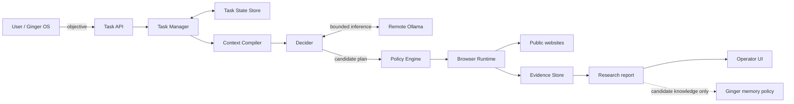
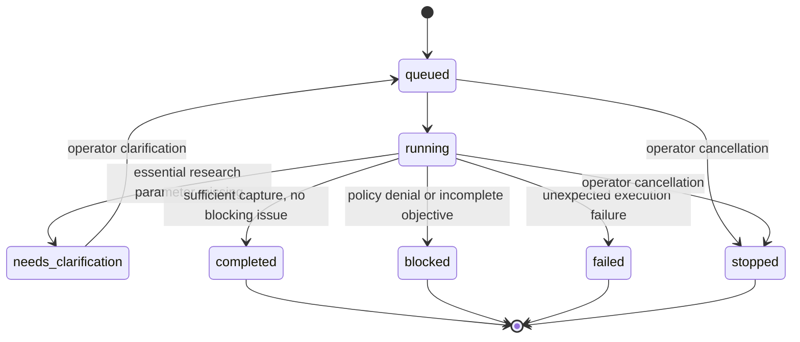
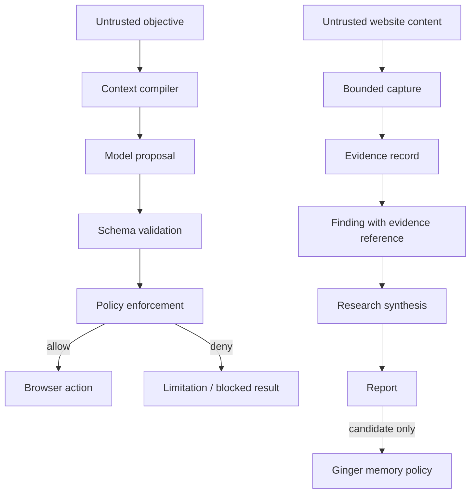

# System architecture

**Status:** current architecture with implementation gaps explicitly called out.  
**Product scope (initial phase):** SEO auditing and website/application QA. General-purpose and deep research are explicitly deferred. Legacy generic research-oriented components remain for compatibility, but new task routing is specialised to SEO and QA; see the implementation status table and `docs/product-scope.md` for current boundaries.

## 1. Design principles

1. **Objective-led:** accept the desired outcome, not a user-authored browser script.
2. **Least privilege:** task plans propose work; policy and runtime enforce what can execute.
3. **Context isolation:** agents receive only the minimum task packet needed for their capability.
4. **Evidence before conclusions:** distinguish what was observed from what is inferred.
5. **Source traceability:** findings should be traceable to source records and evidence.
6. **No silent memory writes:** research may suggest knowledge; Ginger's memory policy decides retention.
7. **Fail visibly:** blocked actions, access failures, ambiguity and uncertainty belong in the report.
8. **Composable output:** structured data is task-specific; the report envelope remains stable.

## 2. Model budget and routing

Ginger Night Walker uses two configured model names, not one model per agent role. `OLLAMA_MODEL_DEFAULT` is the main model (default `qwen3.5:9b`) for goal/task planning, research source selection, navigation planning, and final synthesis. `OLLAMA_MODEL_LIGHT` is the smaller model (default `qwen3.5:4b`) for site interactions (Steel click/type/ref proposals), extraction, bounded recovery proposals, and goal-progress proposals. Both may be served by one remote Ollama instance. Capability workers do not load independent models. Model residency is configured independently with `OLLAMA_KEEP_ALIVE_DEFAULT` and `OLLAMA_KEEP_ALIVE_LIGHT`; each falls back to the legacy `OLLAMA_KEEP_ALIVE` value when unset, then to Ollama's immediate-unload value `0`. Python validates structured outputs and exact evidence quotes; the light model cannot independently mark criteria complete. Operators can point role endpoints at different trusted services, but the runtime model policy remains two-tier.

## 2. Responsibility boundaries

| Component | Owns | Must not own |
|---|---|---|
| Ginger OS / caller | User intent, identity, memory policy and downstream use | Browser implementation details |
| Task API / Task Manager | Task lifecycle, status, clarification, progress events, cancellation, scratchpad coordination and checkpoint recovery | Permission escalation |
| Task State Store | Atomic task snapshots and resumable research checkpoints on the persistent evidence volume | Browser policy or model decisions |
| Context Compiler | Minimal capability-scoped input packets | Shared conversation-history inheritance |
| Goal Analyst / Execution Planner | Measurable success criteria, subtask decomposition, dependencies, required tool declarations and expected outputs | Agent assignment, browser actions, policy grants, truth verification |\n| Decider | Initial research entry point and clarification | Replacing the immutable goal or granting permissions |\n| Agent Allocator | Maps planned capabilities to registered agent identities and emits task assignments | Changing the requested capability or expanding permissions |\n| A2A Bus | Task-scoped assignments, results, assistance requests, handoffs, blockers and status messages | Shared conversation history, permission grants or cross-task messages |
| Goal State Manager | Immutable original objective, model-defined success criteria and evidence-gated progress ledger | Declaring completion without exact captured evidence |
| Task Checklist | Durable Markdown view of the original goal, criteria, subtasks, verified evidence, round log, blockers and completion gate; injected into later planner and synthesis context | Replacing evidence validation or allowing the model to self-mark criteria complete |
| Plan Execution Engine | Mission-scoped plan ledger with stable step IDs, dependency gating, status transitions, evidence references and execution history; updates the Markdown checklist on each persisted transition | Allowing an agent/model to self-authoritatively mark a step complete |
| Optional Strands Decider | Chooses among browser-discovered source candidates | Direct browser access, URL invention or policy decisions |
| Research Loop Guard | Canonical URL deduplication, repeat detection, bounded retries and deterministic source fallback | Changing task goals or relaxing URL policy |
| Policy Engine | URL and capability allow/deny decisions | Model reasoning |
| Browser Runtime | Playwright lifecycle, navigation, capture and runtime enforcement | Memory writes or unsupported actions |
| Evidence Store | Immutable task-scoped capture records | Declaring claims true |
| Research synthesis | Bounded synthesis over source-linked observations, uncertainty and gaps | Changing browser permissions |
| Ginger memory subsystem | Retention, trust, expiry and reuse decisions | Treating every capture as durable memory |

## 3. System context



The dotted memory relationship is a proposal boundary, not an implemented automatic write.

## 4. Task lifecycle



Task records and resumable research checkpoints are persisted as atomic JSON snapshots under `EVIDENCE_DIR/tasks` (or `TASK_STATE_DIR`). On startup, queued/running tasks are restored and resumed from their last checkpoint. A crash during a page inspection may cause that single source to be attempted again; the loop guard bounds retries. Clarification-waiting and terminal tasks are restored without being restarted.

## 5. Browser execution sequence

```mermaid
sequenceDiagram
    participant Caller as Ginger / User
    participant API
    participant TM as Task Manager
    participant D as Decider
    participant LLM as Remote Ollama
    participant P as Policy Engine
    participant B as Browser Runtime
    participant E as Evidence Store
    participant TS as Task State Store
    Caller->>API: POST /tasks objective
    API->>TM: create task
    TM->>TS: persist task and latest checkpoint
    TM->>D: decide objective / initial search URL
    TM->>LLM: extract immutable success criteria (the configured light model)
    LLM-->>TM: criteria proposal; Python stores original goal
    D->>LLM: bounded structured request
    LLM-->>D: candidate DecisionPlan
    D-->>TM: validated plan or clarification
    loop Up to configured SEO/QA page budget (default 200; max 1,000)
        TM->>TM: loop guard deduplicates URLs and detects repeated source/action attempts
        TM->>P: validate discovered public URL
        P-->>B: permitted public URL
        B->>B: isolated Playwright context; capture text and links
        B->>E: persist evidence
        E-->>TM: evidence identifier and observations
        TM->>TS: atomically save completed-round checkpoint
        TM->>TM: append scratchpad and publish progress
        TM->>TM: select next same-origin URL deterministically
    end
    TM->>LLM: evidence-constrained final synthesis
    LLM-->>TM: concise answer and evidence gaps
    TM-->>API: partial/final report and progress events
    API-->>Caller: poll task state; accept follow-ups or cancellation
    API-->>Caller: poll task result
```

## 6. Trust and data flow



Website text, metadata, links and embedded instructions are untrusted input. They must never override system policy, task permissions or model instructions.

## 7. Current implementation status

| Capability | Status | Notes |
|---|---|---|
| Natural-language task intake | Implemented | `POST /tasks` |
| Structured Decider plan | Implemented | Decider-authored step order, objectives, dependencies and capabilities are the sole executable plan; runtime policy may reject a capability but never promotes or rewrites it |
| Goal analysis | Initial implementation | A separate model pass contributes measurable acceptance criteria and interpretation; its suggested subtasks are not executable and cannot replace the Decider plan |
| Plan execution ledger | Initial implementation | One mission-scoped plan per task; dependency-aware step scheduling, durable lifecycle/history, evidence-required completion, Markdown rendering and mission-list progress counts. Orchestrator rejects browser runs without an active step and checks that the requested step ID, capability and objective exactly match the authorised step. Dependent extraction steps remain pinned to the source captured by their navigation step. Capability workers are not yet independent executors. |\n| Capability agent allocation | Initial implementation | Deterministic capability-to-agent mapping; assignments are persisted with task state |\n| A2A coordination | Initial transport | Task-scoped typed assignment/assistance/result/handoff/blocker/status messages; in-process bus and API endpoints; no durable multi-worker broker yet |\n| Goal State Manager | Initial implementation | Uses blueprint criteria and evidence quotes; Python verifies exact quote and evidence ID before completion |
| Markdown goal checklist | Implemented | Atomically persisted per task under `EVIDENCE_DIR/checklists`; included in task snapshots/API responses and seeded into research planning, optional Strands selection and final synthesis; checkboxes derive from the evidence-gated goal ledger |
| Strands Decider integration | Optional | `STRANDS_DECIDER_URL` selects only among discovered source candidates; falls back to Ollama planner; no direct browser tools |
| Task-scoped Playwright context | Implemented | Context is reused across page rounds and closed when the task reaches a terminal state |
| Two-stage tool proposal | Initial implementation | Model selects only from workflow-allowlisted read-only tools; a second structured call fills arguments against the selected Pydantic schema. Proposals are not execution authorisation. |
| Element resolution | Initial implementation | Accessibility-grounded refs only; unique high-confidence matches resolve, ambiguous/no-match cases do not trigger an action. |
| Deterministic action verification | Initial implementation | Python verifies browser status and matching persisted evidence; model evaluation cannot upgrade an unverified result. |
| Run traces | Initial implementation | Redacted per-task JSONL observe/decide/resolve/act/verify/evaluate events; bounded read API and 14-day cleanup. |
| Job timing | Initial implementation | Persisted wall-clock duration and monotonic queue, planning, browser, analysis and reporting stage durations; live elapsed time and phase breakdown in the UI. |
| Compact working memory | Initial implementation | Prompt inputs are bounded independently of durable task snapshots, scratchpad history and immutable evidence. |
| Public URL validation | Implemented | Application-level DNS/IP checks; not a complete egress firewall |
| SEO/QA task routing | Implemented | SEO, QA and combined plans; unrelated general research is blocked in the initial product phase |
| Same-origin SEO/QA crawl | Initial implementation | Breadth-first discovered links and bounded sitemap samples; default 200 pages, configurable to 1,000; coverage remains bounded, not exhaustive |
| robots.txt and sitemap discovery | Initial implementation | Robots policy, sitemap endpoint and bounded sitemap-index expansion; same-origin URLs only |
| SEO duplicate analysis | Initial implementation | Duplicate canonical, title, meta description and exact visible-text fingerprints across inspected pages |
| Internal-link destination verification | Initial implementation | Same-origin HEAD checks with GET fallback when HEAD is explicitly unsupported; redirects are followed manually with per-hop origin and URL-policy validation; off-origin redirects are distinct from broken destinations |
| SEO report prioritisation | Initial implementation | P0-P4 priority, impact score/rationale, effort and remediation guidance; ranking/performance metrics are not inferred |
| QA navigation and interactions | Initial implementation | Read-only by default; explicitly authorised state-changing steps execute only when present in the Decider plan and permitted by runtime policy |
| QA responsive/accessibility smoke checks | Initial implementation | 375/768/1280px overflow, accessible-name and broken ARIA-reference checks, nested controls, positive tabindex, table headers, landmarks, document title/language and six-step keyboard focus sample; not WCAG certification |
| QA browser diagnostics | Initial implementation | Console errors, uncaught page exceptions and failed network requests captured during sampled runs |
| Same-origin anchor navigation | Partial | Heuristic relevant-link following is retained for legacy paths; audit crawling uses deterministic discovery |
| Visible text and heading capture | Implemented | Bounded capture on each inspected source page |
| Immutable evidence JSON | Implemented | Task-scoped file record |
| Task scratchpad | Implemented | Append-only task-scoped round notes; compact recent notes seed the next planner call |
| Progress events | Implemented | Round-completion, follow-up, clarification, cancellation and final milestone events are exposed to the UI |
| Operator cancellation | Implemented | DELETE `/tasks/{task_id}` cancels active work and marks queued/clarification-waiting tasks stopped |
| Durable task snapshots | Implemented | Atomic per-task JSON snapshots under the persistent evidence volume |
| Restart recovery | Initial implementation | Startup restores queued/running tasks; resumes from the last saved round checkpoint; an interrupted in-flight page may be retried once |
| Generic report envelope | Partial | Aggregated multi-source findings, source/evidence references, P0-P4 impact/effort/remediation fields and a UI audit overview for crawl, duplicate, link, responsive and accessibility metrics; richer claim validation remains |
| Product name/price extraction | Legacy partial capability | One task-specific structured-data adapter; not a first-phase workflow |
| General-purpose multi-source research | Deferred for initial product phase | Legacy implementation remains for compatibility; new unsupported objectives are blocked rather than routed to general research |
| Research loop detection and recovery | Initial implementation | Canonical URL deduplication; maximum two attempts per URL; duplicate/ exhausted URLs skipped; deterministic fallback to another discovered candidate; bounded recent outcome history |
| Evidence-constrained synthesis | Initial implementation | Summarises captured titles, headings and visible-text excerpts; gaps are reported |
| Active task follow-ups | Implemented | User instructions are appended to the task context for subsequent rounds |
| Research-grade claim/evidence graph | Partial | Each captured finding carries source and evidence IDs; claim-level validation and conflict graph remain planned |
| Durable multi-worker queue/database | Planned | Current store is single-process atomic JSON, not a transactional multi-worker queue or database |
| Automatic memory retention | Not implemented by design | Ginger owns this decision |
| Arbitrary interaction, form submission, transactions | Not supported | Read-only baseline |

## 8. Scaling path

1. Stabilise and version the report/evidence contracts.
2. Move from single-process JSON snapshots to a transactional task store/queue before introducing multiple workers.
3. Improve source discovery with a configurable search-provider abstraction and relevance filtering.
4. Add stronger finding-to-evidence validation and claim-level extraction.
5. Add source authority, freshness and disagreement analysis.
6. Add retention controls and monitoring schedules only after scheduler, authorization and lifecycle controls exist.
7. Add monitoring schedules only after scheduler, authorization and lifecycle controls exist.
8. Expand browser interaction only through explicit capability grants and independently tested policy enforcement.


## AI browser tab hygiene

Ginger Night Walker retains one primary research tab and runs a lightweight Ollama tab janitor after each capture when secondary tabs exist. The janitor sees only bounded tab metadata (index, title and URL), not page contents, and can recommend closing secondary tabs only. The primary research tab is protected by the browser runtime. The default hard cap is three total tabs (one primary plus up to two secondary), even if the model is unavailable or popup creation is rapid. Set `BROWSER_MAX_TABS` to a value from 1 to 8 to change the immediate popup limit; after AI cleanup, no more than two secondary tabs are retained. The optional `OLLAMA_BASE_URL_BROWSER_CLEANUP` endpoint overrides the shared Ollama URL for this light-model operation. If inference fails, Ginger Night Walker closes all secondary tabs and continues the research task.
